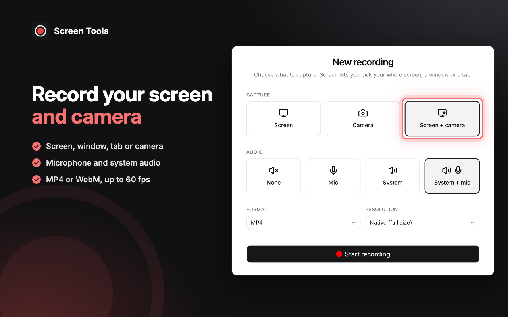
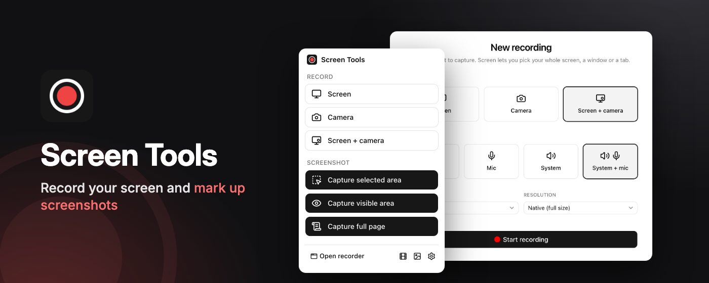

# Listing image style

The visual style for Screen Tools' Chrome Web Store images: the screenshots, the small promo tile and the marquee promo tile. Read it before you design or update a listing image. The UI inside each image comes from the [listing screenshots](../guides/listing-screenshots.md).

Each screenshot puts a crop of real Screen Tools UI on a near-black background, beside a short headline with the benefit in red. One element in the crop is outlined. The colours and motif come from the icon: a white ring and a red dot on a dark rounded square.



## Chrome Web Store rules

The Web Store's [image guidelines](https://developer.chrome.com/docs/webstore/images) and [program policies](https://developer.chrome.com/docs/webstore/program-policies) set these rules. An image that breaks one can get the listing rejected:

| Rule             | What it means here                                                                                  |
| ---------------- | --------------------------------------------------------------------------------------------------- |
| Sizes            | Screenshots are 1280 × 800, the small promo tile 440 × 280, the marquee promo tile 1400 × 560.      |
| Format           | JPEG or 24-bit PNG with no alpha channel.                                                           |
| Real UI          | Each screenshot shows what the extension really does, from a capture, not a mock-up.                |
| Not misleading   | No feature the extension doesn't have, and no claim it can't back up, such as stats or ratings.     |
| No Google brands | No Chrome or Google logos, or anything else that suggests Google made or endorses the extension.    |
| Promo tiles      | The small tile reads at small sizes: mostly the logo and name, with little text and no screenshots. |

The listing takes up to 5 screenshots and needs at least one.

## Canvas

Each screenshot is a 1280 × 800 page, rendered at 1× and saved as a PNG. Captures are 2×, so a crop can be enlarged up to 2× and stay sharp.

Keep text and the logo inside an 80 px margin on the left and a 56 px margin on the top. UI crops can run off the right and bottom edges.

## Colour

| Token      | Value                                | Use                                                 |
| ---------- | ------------------------------------ | --------------------------------------------------- |
| Background | `#111113`                            | The base fill of every image                        |
| Grey glow  | `#404048` at 70%, radial, top right  | Depth behind the UI                                 |
| Red glow   | `#EF4444` at 26%, radial, bottom left | Warmth behind the text                              |
| Headline   | `#FFFFFF`                            | Headline text                                       |
| Accent     | `#F87171`                            | Headline highlight, ticks, outlines, motif          |
| Body       | `#E4E4E7`                            | Tick text and taglines                              |
| Tick mark  | `#111113`                            | The check inside each tick                          |

The accent is a lighter tint of the icon's red dot (`#EF4444`), which on its own is too dark for text on this background. Every text pairing passes 4.5:1: white on the background is 18.9:1, the accent 6.8:1, the body colour 14.9:1, and the tick mark on the accent 6.8:1.

## Type

| Element  | Font          | Size  | Weight | Notes                                                 |
| -------- | ------------- | ----- | ------ | ----------------------------------------------------- |
| Headline | Inter Display | 52 px | 700    | Line height 1.08, letter spacing −1%, 2 lines at most |
| Tick     | Inter         | 20 px | 500    | 16 px between items, 24 px tick                       |
| Logo     | Inter         | 22 px | 600    | 44 px `public/icon/128.png` and "Screen Tools", top left |

Inter loads from `rsms.me`, so build the images online. Offline, the headline falls back to the system sans-serif.

## Layouts

| Layout     | Use                           | Text                                                      | UI                                                    |
| ---------- | ----------------------------- | --------------------------------------------------------- | ----------------------------------------------------- |
| Split      | Screenshots of a compact view | Left, 460 px wide, from 210 px down                       | One crop on the right, from about 580 px across       |
| Stacked    | Screenshots of a wide view    | Headline 124 px down, ticks in a row below it             | One wide crop from 262 px down, off the bottom edge   |
| Small tile | Small promo tile              | Icon, name and a 2-line tagline, centred                  | None                                                  |
| Marquee    | Marquee promo tile            | Icon, name and tagline on the left, 420 px wide           | The toolbar menu in front of the Record page          |

Use Stacked when a split crop would shrink the UI's text below about 12 px, as with the editor and Latest videos.



## UI crops

Crop each capture to the part of the view the headline talks about. Give it a 14 px corner radius, a shadow (`0 26px 70px` black at 55%) and a 1 px white edge at 8%.

Never redraw or edit the UI. If a capture needs different data, change the [data](../guides/listing-screenshots.md#the-data) and capture again.

## Highlight

Outline the single element that proves the headline, such as the Screen + camera tile. The outline is 3 px of the accent with a 12 px radius, 8 px outside the element, with a soft accent glow. Keep it inside the crop.

## Motif

Each image carries one large outline of the icon, the ring and dot, in the accent at 7%. Place it partly off the canvas, away from the headline.

## Copy

- Write the headline in sentence case, in 6 words or fewer.
- Colour the last 2 or 3 words of the headline in the accent: the words that carry the benefit.
- Give each screenshot 3 ticks of 7 words or fewer.
- Use the extension's own words for features: Latest videos, Screen + camera, Capture full page.
- Describe only what the UI in the image does. Don't add numbers, comparisons or results.

## Image set

The `IMAGES` list in [`scripts/build-showcase.ts`](../../scripts/build-showcase.ts) sets each image's layout, headline, ticks, crops, highlight and alt text. To build all of them from fresh captures, run:

```bash
pnpm screenshots
pnpm showcase
```

The script writes upload-ready PNGs to `out/showcase/`, with each image's alt text in `alt-text.txt`:

| File                       | Size       | Shows                                        |
| -------------------------- | ---------- | -------------------------------------------- |
| `01-record.png`            | 1280 × 800 | Record page, Screen + camera outlined        |
| `02-screenshot-editor.png` | 1280 × 800 | Editor with annotations, tools outlined      |
| `03-latest-videos.png`     | 1280 × 800 | Latest videos, the recovered video outlined  |
| `04-save-smaller.png`      | 1280 × 800 | Save dialog, the Balanced preset outlined    |
| `05-toolbar.png`           | 1280 × 800 | Toolbar menu, the screenshot buttons outlined |
| `small-promo-tile.png`     | 440 × 280  | Icon, name and tagline                       |
| `marquee-promo-tile.png`   | 1400 × 560 | Icon, name, toolbar menu and Record page     |

The script stops if a capture is missing or an image comes out with an alpha channel. It takes its colours, type and layouts from this guide, so change a style here and in the script together. Crops are in CSS pixels of the capture, half its pixel size, so when a view's layout moves, update its crop in the script.

The Screenshots list and player captures stay out of the set as spares: the editor and Latest videos show the same features with more to see.

## Checklist

Check each image before you upload it:

- The size matches the table above, and `file` reports `8-bit/color RGB`, not `RGBA`.
- The UI is the main subject of every screenshot, and it comes from a capture.
- No Chrome or Google logo, browser bar, stat or rating appears anywhere.
- All data comes from the made-up samples, with no real person, email or site.
- The headline has 6 words or fewer, and there's one outline at most.
- No two screenshots show the same view.
